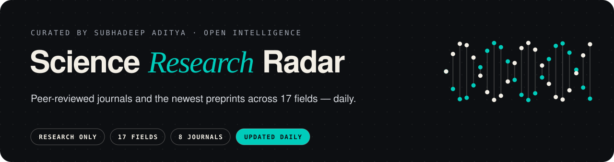
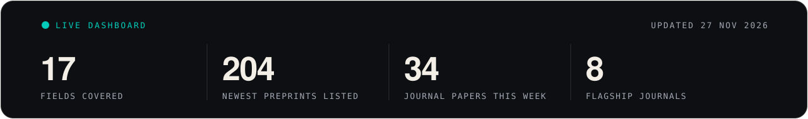
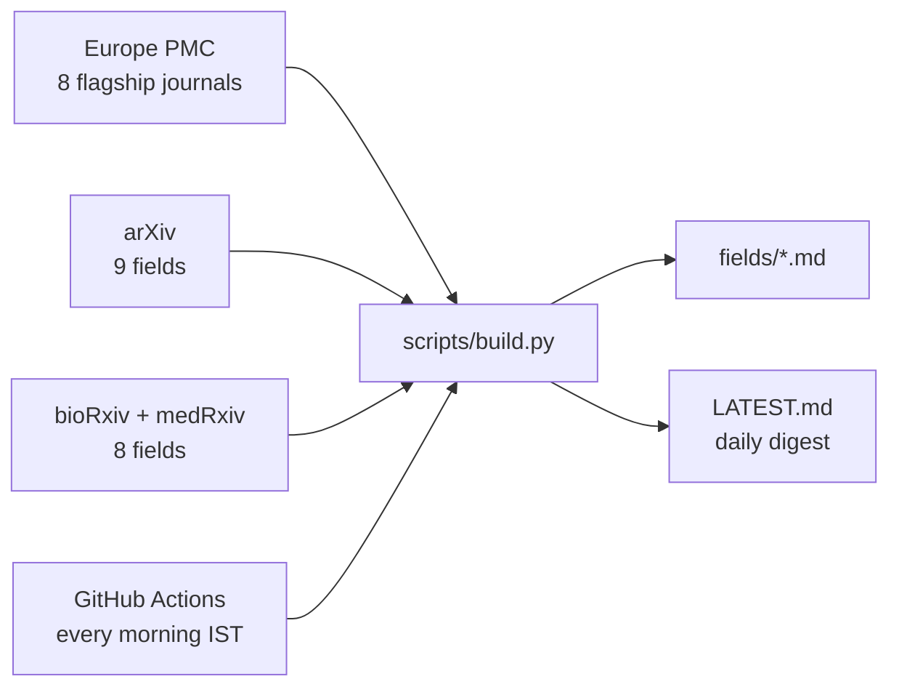

  
  
  
  
  

<b>Every new development in science — straight from the research itself, not the headlines.</b> 
Flagship peer-reviewed journals plus the newest preprints across 17 fields, refreshed automatically every morning.

  <a href="LATEST.md"><b>🛰️ Today's research digest</b></a> ·
  <a href="fields/journals.md">📚 Peer-reviewed journals</a> ·
  <a href="#-fields">🗂️ Fields</a> ·
  <a href="#-free-research-toolkit">🧰 Free research toolkit</a>

## 🔥 This week in the top journals

One newly published research article from each flagship journal — refreshed every morning (IST).

| Journal | Paper | Published |
|:--|:--|:--|
| **Nature** | [Continuous N-to-C Peptide Synthesis](https://doi.org/10.1038/s41586-026-11448-w) | 2026-11-23 |
| **Science** | [A neural code for generative speech production in human Wernicke's area](https://doi.org/10.1126/science.aef8963) | 2026-11-19 |
| **Cell** | [Neural correlates of facial recognition in a social wasp](https://doi.org/10.1016/j.cell.2026.10.052) | 2026-11-23 |
| **The New England Journal of Medicine** | [From Cold War Politics to Hot Domestic Politics - The Epidemic Intelligence Service at 75](https://doi.org/10.1056/nejmp2606018) | 2026-11-21 |
| **The Lancet** | [Seasonal mass vaccination with R21/Matrix-M against malaria in The Gambia and Burkina Faso: an open-label, cluster-randomised, controlled trial](https://doi.org/10.1016/s0140-6736(26)01562-x) | 2026-11-19 |
| **Nature Medicine** | [Expansion and cytotoxicity of mucosal CAR+ T cells in enterocolitis associated with BCMA CAR-T cell therapy](https://doi.org/10.1038/s41591-026-04731-w) | 2026-11-19 |
| **Nature Biotechnology** | [A unified framework for scalable differential testing for spatial omics](https://doi.org/10.1038/s41587-026-03284-0) | 2026-11-23 |
| **PNAS** | [A chromatin biology assessment of AlphaFold3](https://doi.org/10.1073/pnas.2621340123) | 2026-11-23 |

<a href="LATEST.md"><b>Full research digest →</b></a>

---

## 🎯 Why "research only"

Science news often arrives late, simplified, or exaggerated. This radar links **only to primary research** — the papers themselves — so you see discoveries the day they're published:

| Layer | Source | What it means |
|:--|:--|:--|
| 📚 **Peer-reviewed** | Nature · Science · Cell · NEJM · The Lancet · Nature Medicine · Nature Biotechnology · PNAS | Checked by expert reviewers — the highest bar |
| 📄 **Preprints** | arXiv · bioRxiv · medRxiv | Newest work, shared before peer review — fastest, but preliminary |

---

## 🗂️ Fields

| Physical & computational sciences | Life sciences | Health |
|:--|:--|:--|
| 🤖 [AI & Computing](fields/ai-computing.md) | 🧬 [Genomics & Genetics](fields/genomics.md) | 🩺 [Medicine & Public Health](fields/medicine.md) |
| 🦾 [Robotics](fields/robotics.md) | 🧠 [Neuroscience](fields/neuroscience.md) | 🎯 [Cancer Research](fields/cancer.md) |
| ⚛️ [Physics](fields/physics.md) | 🔬 [Cell & Molecular Biology](fields/cell-molecular.md) | 📚 [Flagship journals](fields/journals.md) |
| 🌀 [Quantum Science](fields/quantum.md) | 🦠 [Microbiology & Immunology](fields/microbes-immunity.md) | |
| 🔭 [Astronomy & Space](fields/astronomy-space.md) | 🛠️ [Synthetic Biology & Bioengineering](fields/synbio-bioeng.md) | |
| 🔋 [Materials & Energy](fields/materials-energy.md) | 🌿 [Ecology & Evolution](fields/ecology-evolution.md) | |
| 🧪 [Chemistry](fields/chemistry.md) | | |
| 🌍 [Earth & Climate](fields/earth-climate.md) | | |
| ➗ [Mathematics](fields/mathematics.md) | | |

---

## 🧰 Free research toolkit

| Task | Free tools |
|:--|:--|
| **Search the literature** | [Google Scholar](https://scholar.google.com) · [PubMed](https://pubmed.ncbi.nlm.nih.gov) · [Europe PMC](https://europepmc.org) · [Semantic Scholar](https://www.semanticscholar.org) · [OpenAlex](https://openalex.org) · [BASE](https://www.base-search.net) |
| **Read papers free (legally)** | [Unpaywall](https://unpaywall.org) · [PubMed Central](https://www.ncbi.nlm.nih.gov/pmc/) · [arXiv](https://arxiv.org) · [bioRxiv](https://www.biorxiv.org) · [medRxiv](https://www.medrxiv.org) · [DOAJ](https://doaj.org) · [CORE](https://core.ac.uk) |
| **Map a research field** | [Connected Papers](https://www.connectedpapers.com) · [ResearchRabbit](https://www.researchrabbit.ai) · [Litmaps](https://www.litmaps.com) · [Inciteful](https://inciteful.xyz) |
| **AI research assistants** | [Elicit](https://elicit.com) · [Consensus](https://consensus.app) · [Scite](https://scite.ai) · [NotebookLM](https://notebooklm.google.com) |
| **Manage references** | [Zotero](https://www.zotero.org) · [Mendeley](https://www.mendeley.com) |
| **Write & publish** | [Overleaf (LaTeX)](https://www.overleaf.com) · [Zenodo (DOIs for data/code)](https://zenodo.org) · [OSF](https://osf.io) · [ORCID](https://orcid.org) |
| **Data & code** | [Hugging Face Papers](https://huggingface.co/papers) · [Figshare](https://figshare.com) · [Dryad](https://datadryad.org) · [Kaggle Datasets](https://www.kaggle.com/datasets) |
| **Check quality** | [Retraction Watch Database](https://retractiondatabase.org) · [PubPeer](https://pubpeer.com) · [DOAJ journal check](https://doaj.org) · [Think. Check. Submit.](https://thinkchecksubmit.org) |
| **Clinical & health evidence** | [ClinicalTrials.gov](https://clinicaltrials.gov) · [Cochrane Library](https://www.cochranelibrary.com) · [WHO IRIS](https://iris.who.int) |
| **Follow by alert** | [Google Scholar Alerts](https://scholar.google.com/scholar_alerts?view_op=list_alerts) · [arXiv email lists](https://info.arxiv.org/help/subscribe.html) · [bioRxiv alerts & RSS](https://www.biorxiv.org/alertsrss) |

### How to read a preprint critically
1. **Who and where?** Check the authors' track record and institution.
2. **How big?** Small samples and single experiments are fragile.
3. **Compared to what?** Look for controls and baselines.
4. **Replicated?** One study is a lead, not a conclusion.
5. **Later version?** Search the title — it may since have been peer-reviewed, revised, or withdrawn.

---

## ⚙️ How it works

All sources are free public APIs. Only titles, authors and links are stored — read the full papers at the source.

---

## 🔗 Part of the Open Knowledge series

| Learn | Track |
|:--|:--|
| [Awesome Biotechnology](https://github.com/Subhadeep998/Awesome-Biotechnology) · [Awesome AI Learning](https://github.com/Subhadeep998/Awesome-AI-Learning) · [Open Biology Handbook](https://github.com/Subhadeep998/Open-Biology-Handbook) | **Science Research Radar** · [Global Company Radar](https://github.com/Subhadeep998/Global-Company-Radar) · [Law Firm Radar](https://github.com/Subhadeep998/Law-Firm-Radar) · [AI Developer Docs Hub](https://github.com/Subhadeep998/AI-Developer-Docs-Hub) |

  ⭐ <b>Star</b> to bookmark · 👤 <a href="https://github.com/Subhadeep998"><b>Follow @Subhadeep998</b></a> 
  Built by <a href="https://subhadeep998.github.io">Subhadeep Aditya</a> — biotechnologist and independent researcher · Kolkata, India

